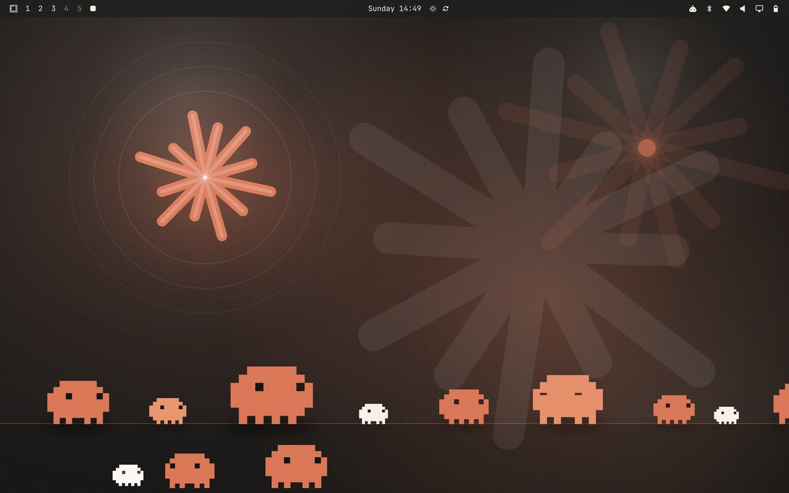
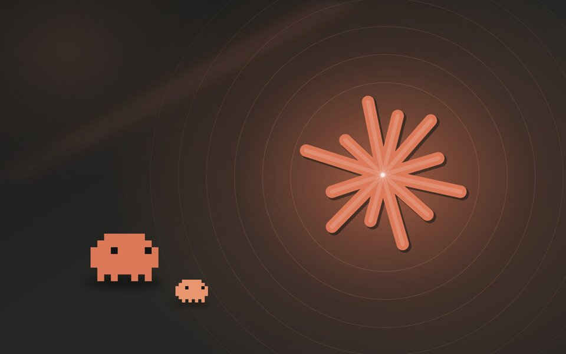
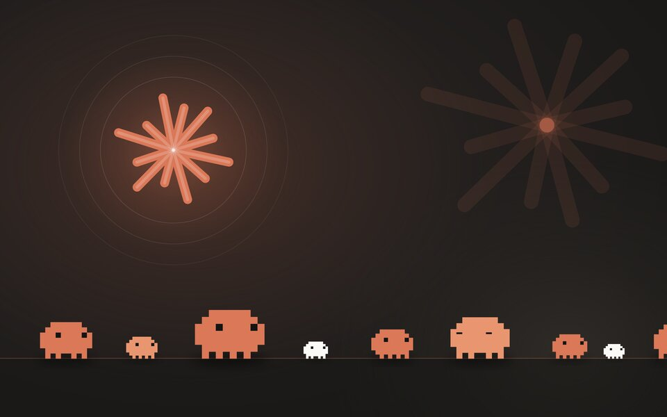
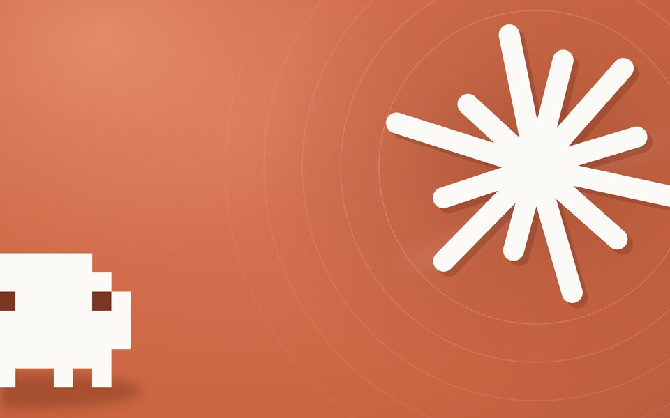
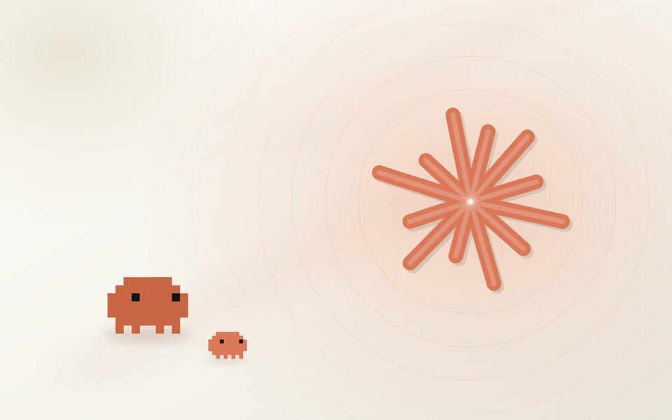
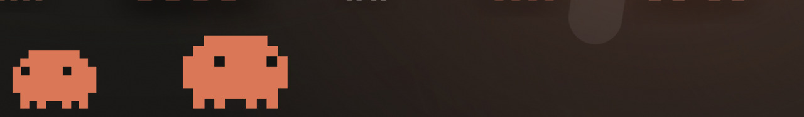

# Claude theme for Omarchy

Un tema para [Omarchy](https://omarchy.org) con la paleta de Claude (terracota, crema y grises cálidos), fondos generados por código con Clawd, la mascota pixelada de Claude Code, bordes que giran, animaciones con rebote y una capa de escritorio animada en la que tres Clawds pasean por el borde inferior de la pantalla.



*[English below](#english)*

## Qué incluye

- **Tres fondos** a 3840x2400, generados desde SVG por `tools/gen-backgrounds.py`:

  | | |
  |---|---|
  |  **ember** |  **parade** |
  |  **terracotta bloom** |  **cream bloom** (Claude Light) |

- **Hyprland con vida** (`hyprland.lua`): borde activo con degradado terracota, ámbar y crema que gira en bucle, esquinas redondeadas, sombras teñidas, blur en menús y popups, ventanas que entran con rebote, cambio de espacio con deslizamiento y terminal ligeramente translúcida.
- **Barra, menús, lanzador, polkit y bloqueo** a juego (`shell.toml`).
- **Claude Light**, la variante clara, en `light/`.
- **Claude Aura**, un plugin del shell de Omarchy (`aura/`) que dibuja una capa animada entre el fondo y las ventanas: halos que derivan, un asterisco enorme que gira lentamente y tres Clawds que andan, paran, parpadean, miran a los lados y se dan la vuelta. No captura ratón ni teclado y solo se enciende cuando el tema activo es Claude o Claude Light.

  

## Instalación

```bash
git clone https://github.com/answer2002/omarchy-claude-theme
cd omarchy-claude-theme
./install.sh
```

El script copia el tema oscuro, el claro y el plugin a `~/.config/omarchy/`, activa el plugin en `shell.json` y aplica el tema.

También funciona el instalador de Omarchy, pero **descarta `hyprland.lua`** porque un tema clonado de un repo no puede traer Lua. Te quedarías sin bordes giratorios, animaciones ni plugin:

```bash
omarchy theme install https://github.com/answer2002/omarchy-claude-theme
```

Para desinstalar, `./uninstall.sh`. Para dejar solo el tema sin la capa animada, `./install.sh --no-aura`.

## Uso

```bash
omarchy theme bg next              # siguiente fondo
omarchy theme set claude-light     # variante clara
omarchy-shell claude-aura status   # estado del plugin animado
```

## Ajustes

En `aura/Aura.qml`, arriba del todo:

| Propiedad | Por defecto | Qué hace |
|---|---|---|
| `fps` | 20 | Fotogramas por segundo de la capa. Toda la animación sale de un reloj propio, así que bajar esto baja el consumo. |
| `intensity` | 1.0 (0.55 en claro) | Fuerza de los halos. |
| `clawds` | 3 | Cuántos Clawds pasean. |

Coste medido en un portátil con GPU integrada AMD: el shell de Omarchy pasa de 0 a un 3-5% de un núcleo; el giro de bordes de Hyprland añade otro 4%. Si quieres apagar la capa animada sin desinstalar, quita `answer.claude-aura` de `plugins` en `~/.config/omarchy/shell.json`.

## Regenerar los fondos

```bash
tools/build.sh    # necesita python3, rsvg-convert y magick
```

Cambia colores, posiciones o el número de Clawds en `tools/gen-backgrounds.py`. La función `clawd()` dibuja la mascota en una rejilla de 10x7 celdas con poses: mirada a un lado, parpadeo y tres posiciones de patas.

## Créditos

Claude, el asterisco y Clawd son de [Anthropic](https://www.anthropic.com). Este tema es un proyecto de fan sin relación con Anthropic. Hecho con Claude Code, para Claude Code. Código bajo licencia MIT.

---

## English

A theme for [Omarchy](https://omarchy.org) using Claude's palette (terracotta, cream, warm greys), code-generated wallpapers featuring Clawd, the pixel mascot of Claude Code, rotating gradient borders, springy window animations, and an animated desktop layer where three Clawds stroll along the bottom of the screen.

**Install** with `./install.sh` after cloning. This copies the dark theme, the light theme and the shell plugin into `~/.config/omarchy/`, enables the plugin and applies the theme. `omarchy theme install <url>` also works but drops `hyprland.lua`, so you would lose the rotating borders, animations and the plugin.

**Tweak** `fps`, `intensity` and `clawds` at the top of `aura/Aura.qml`. Regenerate wallpapers with `tools/build.sh`.

Claude, the asterisk mark and Clawd belong to Anthropic. This is a fan project, not affiliated with Anthropic. MIT licensed.
